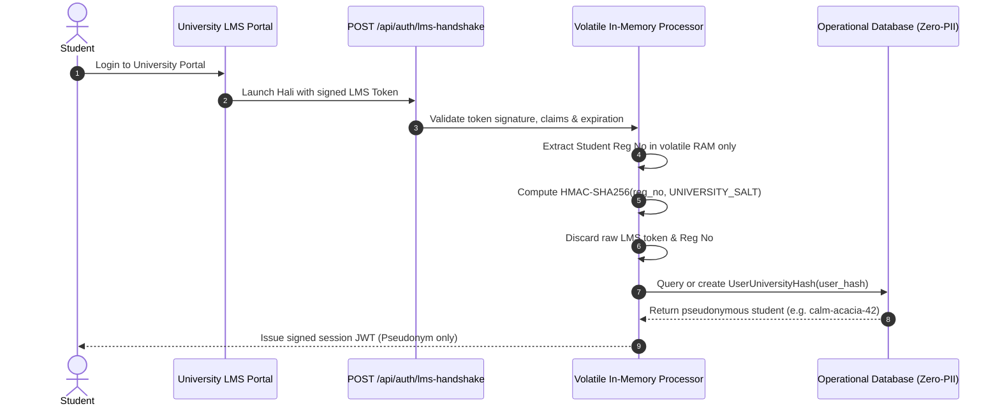
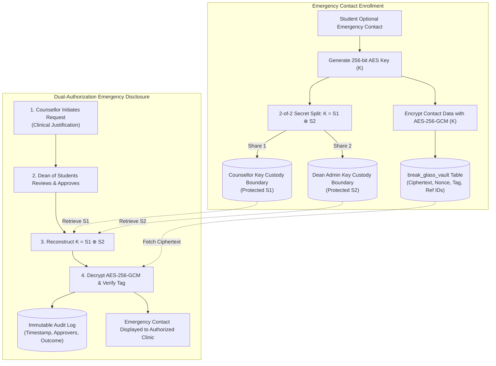
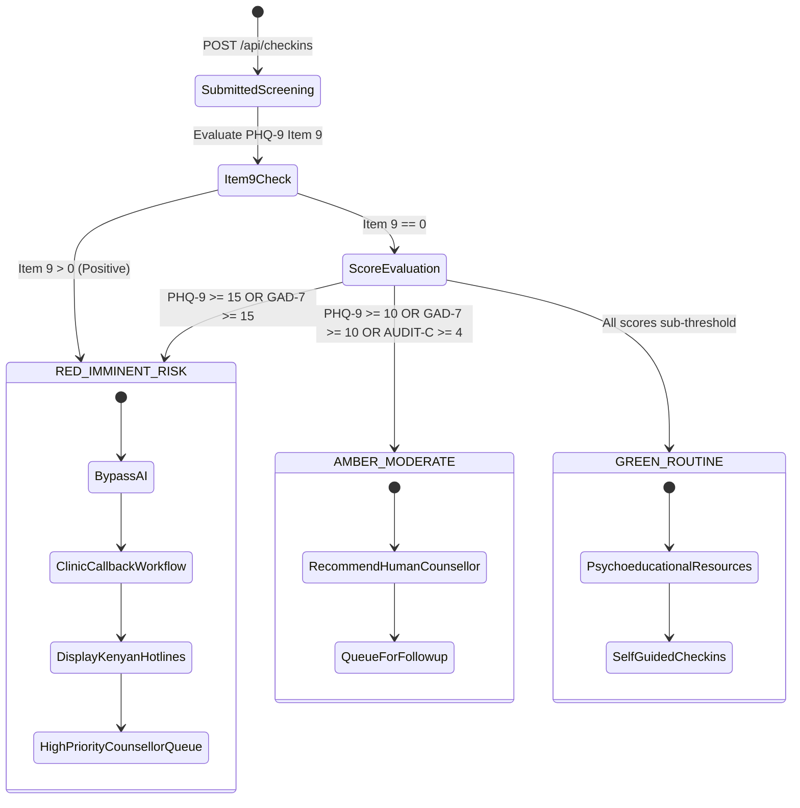

# Hali Architecture & System Design

Hali is a privacy-first university mental health triage and student welfare operating system designed for deployment within university e-Learning portals (LMS) in Kenya.

---

## 1. Zero-PII Authentication Handshake Pipeline

---

## 2. Dual-Key Break-Glass Vault Architecture

---

## 3. Deterministic Triage State Machine

---

## 4. Multi-Tenant Row-Level Security (RLS)

All 22 operational tables in Hali enforce PostgreSQL Row-Level Security:
- `university_id` is mandatory and foreign-keyed to `universities.id`.
- The application executes `SELECT set_config('app.current_university_id', :uid, true)` per database transaction.
- Rows where `university_id != app.current_university_id` are invisible to SQL queries, even if application code omits an explicit tenant filter.
- Connection role `hali_app` does not have `BYPASSRLS` privileges.

