# Hali Database Entity-Relationship Diagram (ERD)

This document specifies the PostgreSQL 2.0 database architecture for **Hali**, highlighting multi-tenancy, Row-Level Security (RLS), and zero-PII storage.

```mermaid
erDiagram
    universities ||--o{ university_settings : has
    universities ||--o{ users : isolates
    universities ||--o{ user_university_hashes : secures
    universities ||--o{ checkins : scopes
    universities ||--o{ risk_events : tracks
    universities ||--o{ break_glass_vault : vaults
    universities ||--o{ counsellor_profiles : employs
    universities ||--o{ bookings : schedules
    universities ||--o{ consent_ledger : audits

    users ||--o{ user_roles : assigned
    roles ||--o{ user_roles : classifies
    users ||--o| user_university_hashes : "1-to-1 keyed HMAC"
    users ||--o{ checkins : logs
    users ||--o{ phq9_assessments : submits
    users ||--o{ gad7_assessments : submits
    users ||--o{ auditc_assessments : submits
    users ||--o{ risk_events : triggers
    users ||--o| break_glass_vault : "dual-key encrypted"
    users ||--o{ consent_ledger : grants_or_withdraws

    risk_events ||--o{ escalations : creates
    break_glass_vault ||--o{ break_glass_requests : accesses
    counsellor_profiles ||--o{ counsellor_availability : defines
    counsellor_profiles ||--o{ session_notes : records
    counsellor_profiles ||--o{ bookings : attends

    universities {
        uuid id PK
        string name
        string code UK
        string slug UK
        string salt "HMAC salt"
        boolean is_active
        timestamp created_at
    }

    university_settings {
        uuid id PK
        uuid university_id FK
        integer k_anonymity_threshold "Default 15"
        integer red_threshold_phq9 "Default 15"
        integer red_threshold_gad7 "Default 15"
        json crisis_hotlines
    }

    users {
        uuid id PK
        uuid university_id FK
        string anon_handle "Pseudonym e.g. calm-acacia-42"
        string role "student, counsellor, admin, dean"
        string faculty
        string department
        integer year_of_study
        string password_hash "Argon2id for staff only"
        string staff_email "Staff only (NULL for students)"
        string staff_name "Staff only (NULL for students)"
    }

    user_university_hashes {
        uuid id PK
        uuid university_id FK
        uuid user_uuid FK
        string user_hash "HMAC-SHA256(reg_no, salt)"
    }

    checkins {
        uuid id PK
        uuid university_id FK
        uuid user_uuid FK
        integer mood_score
        string mood_label
        text reflection_note "PII-sanitized"
        string checkin_type
    }

    phq9_assessments {
        uuid id PK
        uuid university_id FK
        uuid user_uuid FK
        json item_scores "9 items [0..3]"
        integer total_score
        integer item_9_score "Critical safety indicator"
        string severity
    }

    gad7_assessments {
        uuid id PK
        uuid university_id FK
        uuid user_uuid FK
        json item_scores "7 items [0..3]"
        integer total_score
        string severity
    }

    risk_events {
        uuid id PK
        uuid university_id FK
        uuid user_uuid FK
        string risk_level "GREEN, AMBER, RED"
        string trigger_reason
        boolean item9_positive
        integer phq9_score
        integer gad7_score
    }

    escalations {
        uuid id PK
        uuid university_id FK
        uuid risk_event_id FK
        uuid user_uuid FK
        string escalation_tier "RED_IMMINENT_RISK"
        string status "PENDING, ACKNOWLEDGED, RESOLVED"
        string idempotency_key UK
    }

    break_glass_vault {
        uuid id PK
        uuid university_id FK
        uuid user_uuid FK
        text encrypted_contact "AES-256-GCM ciphertext"
        string nonce "12-byte GCM IV"
        string authentication_tag "16-byte GCM tag"
        string counsellor_key_share_reference
        string dean_admin_key_share_reference
    }

    break_glass_requests {
        uuid id PK
        uuid university_id FK
        uuid vault_id FK
        uuid user_uuid FK
        uuid requesting_counsellor_uuid FK
        uuid approving_dean_admin_uuid FK
        text reason "Mandatory clinical justification"
        string status "PENDING_APPROVAL, APPROVED_DECRYPTED"
        string decryption_outcome
    }

    consent_ledger {
        uuid id PK
        uuid university_id FK
        uuid user_uuid FK
        string consent_scope "deidentified_research"
        boolean granted
        timestamp granted_at
        timestamp withdrawn_at
    }
```

---

## Zero-PII Architectural Guarantees

1. **No Student Reg Numbers Stored**: The operational database only ever contains `user_university_hashes.user_hash`, a one-way keyed HMAC-SHA256 digest.
2. **No Student Names / Personal Emails**: Student accounts use randomized nature pseudonyms (e.g., `calm-acacia-42`). Columns `staff_name` and `staff_email` are strictly null for all student records.
3. **Dual-Key Emergency Vault Separation**: Emergency contact information is encrypted with AES-256-GCM and its 32-byte key is split using 2-of-2 secret sharing ($S_1 \oplus S_2$). Neither the counsellor nor the dean of students can decrypt the record independently.
4. **PostgreSQL Row-Level Security (RLS)**: Enforced via `ALTER TABLE ... FORCE ROW LEVEL SECURITY` on all tenant operational tables, preventing cross-tenant data leakage at the PostgreSQL query engine level.

